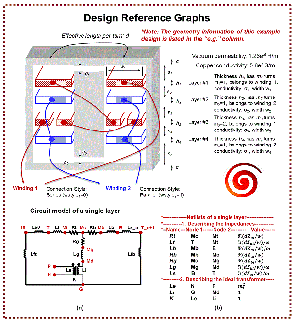

  <section class="m2spice-shell" aria-labelledby="m2spice-title">
    

      
      

        
Princeton Power Electronics Tool

        <h2 id="m2spice-title">Planar magnetics to SPICE netlist conversion</h2>
        
M2Spice converts multilayer planar magnetic geometry into a SPICE-compatible equivalent circuit netlist.

      

    

    

      <a class="m2spice-button" href="https://github.com/minjiechen/M2Spice" title="Open source repository" aria-label="Open source repository">
        <i class="fa-brands fa-github" aria-hidden="true"></i>
        Source
      </a>
      <button class="m2spice-button" type="button" data-action="example" title="Load example geometry" aria-label="Load example geometry">
        <i class="fa-solid fa-wand-magic-sparkles" aria-hidden="true"></i>
        Example
      </button>
      <button class="m2spice-button" type="button" data-action="clear" title="Clear geometry" aria-label="Clear geometry">
        <i class="fa-solid fa-rotate-left" aria-hidden="true"></i>
        Clear
      </button>
      <a class="m2spice-button" href="/m2spice-dab/" title="Dual-active-bridge converter with LLG-SPICE magnetics" aria-label="Usage example: DAB converter">
        <i class="fa-solid fa-wave-square" aria-hidden="true"></i>
        Usage Example
      </a>
    

  </section>

  <section class="m2spice-tool" aria-label="M2Spice geometry input">
    <form class="m2spice-form" data-form novalidate>
      

        <h2>Geometry</h2>
      

      

        <h3>Operating Point</h3>
        

      

      

        <h3>Layer Stack</h3>
        

      

      

        <h3>Windings and Core</h3>
        

      

      

        <h3>Core Model</h3>
        

          

            <label for="m2spice-core-model">Ferrite Model</label>
            <select class="m2spice-input" id="m2spice-core-model" data-llg-mode>
              <option value="linear">Linear (M2Spice netlist)</option>
              <option value="llg">LLG-SPICE nonlinear (LTspice block)</option>
            </select>
            LLG-SPICE replaces both ferrite plates with Landau-Lifshitz-Gilbert cores
          

        

      

      

        

          <h3>Core Operating Point</h3>
          

        

      

      

        <button class="m2spice-button is-primary" type="button" data-action="llg-extract" data-llg-only hidden title="Fit the LLG core to the MagNet loop" aria-label="Extract parameters">
          <i class="fa-solid fa-wave-square" aria-hidden="true"></i>
          Extract Parameters
        </button>
        <button class="m2spice-button is-primary" type="button" data-action="check" title="Check geometry" aria-label="Check geometry">
          <i class="fa-solid fa-circle-check" aria-hidden="true"></i>
          Check
        </button>
        <button class="m2spice-button is-primary" type="button" data-action="generate" title="Generate netlist" aria-label="Generate netlist">
          <i class="fa-solid fa-bolt" aria-hidden="true"></i>
          Generate
        </button>
        <progress class="m2spice-progress" data-llg-progress max="1" value="0" hidden></progress>
        
      

      

        <h2>Status</h2>
        
Load the example or enter geometry values to begin.

      

      

        

      

    </form>

    <aside class="m2spice-side" aria-label="B-H loop preview and design guide">

      <figure class="m2spice-preview" data-llg-preview hidden>
        <h2>B-H Loop</h2>
        

        

          <i class="m2spice-key is-nn"></i>MagNet NN (reference)
          <i class="m2spice-key is-llg"></i>LLG fit
        

        

        

          
Loop data (129 samples)

          

        

      </figure>

      <figure class="m2spice-guide">
        
        <figcaption>Design guide for winding layer indices, spacing, and core geometry.</figcaption>
      </figure>
    </aside>
  </section>

  <section class="m2spice-editor" aria-label="Geometry editor and netlist output">
    

      

        <h2>Geometry Text</h2>
        

          <button class="m2spice-button" type="button" data-action="sync-geometry" title="Update text from form" aria-label="Update text from form">
            <i class="fa-solid fa-arrow-down-short-wide" aria-hidden="true"></i>
            Update
          </button>
          <button class="m2spice-button" type="button" data-action="apply-geometry" title="Apply text to form" aria-label="Apply text to form">
            <i class="fa-solid fa-arrow-up-from-bracket" aria-hidden="true"></i>
            Apply
          </button>
        

      

      <textarea class="m2spice-textarea" data-geometry-text spellcheck="false" aria-label="Geometry text"></textarea>
    

    

      

        <h2 data-netlist-title>SPICE Netlist</h2>
        

          <button class="m2spice-button" type="button" data-action="copy-netlist" title="Copy netlist" aria-label="Copy netlist">
            <i class="fa-solid fa-copy" aria-hidden="true"></i>
            Copy
          </button>
          <button class="m2spice-button" type="button" data-action="download-netlist" title="Download netlist" aria-label="Download netlist">
            <i class="fa-solid fa-download" aria-hidden="true"></i>
            Download
          </button>
          <button class="m2spice-button" type="button" data-action="llg-download-all" data-llg-only hidden title="Download the .lib and .asy as a zip" aria-label="Download all files as zip">
            <i class="fa-solid fa-file-zipper" aria-hidden="true"></i>
            Download all
          </button>
        

      

      

        <button class="m2spice-tab is-active" type="button" role="tab" aria-selected="true" data-action="llg-tab" data-llg-tab data-tab="lib">Library .lib</button>
        <button class="m2spice-tab" type="button" role="tab" aria-selected="false" data-action="llg-tab" data-llg-tab data-tab="asy">Symbol .asy</button>      

      

      <textarea class="m2spice-textarea" data-netlist spellcheck="false" aria-label="Generated SPICE netlist" readonly></textarea>
    

  </section>

